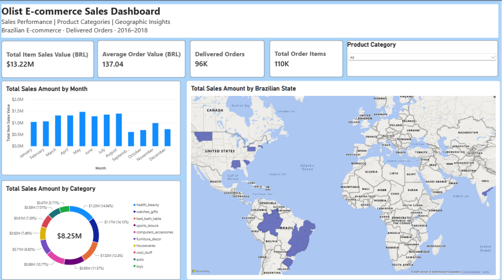

# Olist E-Commerce Sales Analysis

## Project Overview

This project analyses the Brazilian E-Commerce Public Dataset by Olist to understand sales performance and identify useful business insights.

MySQL was used for data preparation, data quality checks, table joins, and sales analysis. Power BI Desktop was used to develop an interactive dashboard to present key performance indicators and explore sales trends across different business dimensions.

## Business Objectives

- Analyse monthly and yearly sales trends.
- Identify product categories with the highest and lowest sales values.
- Examine sales performance alongside order volume and average order value.
- Compare sales performance across Brazilian states.
- Identify the top-performing product categories by item sales value.
- Evaluate average order value across product categories.

## Tools and Technologies

- **MySQL:** Data preparation, data quality checks, joins, aggregations, and sales analysis.
- **Power BI Desktop:** Data modelling, DAX measures, dashboard development, and visualisation.
- **GitHub:** Project documentation, SQL scripts, and version control.

## Dataset

**Source:** [Brazilian E-Commerce Public Dataset by Olist on Kaggle](https://www.kaggle.com/datasets/olistbr/brazilian-ecommerce)

Five datasets were used in this project:

| Dataset | Purpose |
|---|---|
| `olist_customers_dataset` | Customer information, including customer IDs and geographic details |
| `olist_order_items_dataset` | Order items, product IDs, item prices, and freight values |
| `olist_orders_dataset` | Order IDs, purchase dates, and order statuses |
| `olist_products_dataset` | Product information and product category names |
| `product_category_name_translation` | Translates product category names from Portuguese into English |

These datasets were joined using relevant identifiers to prepare the data for sales analysis.

## Repository Structure

```text
olist-ecommerce-analysis/
├── README.md
├── sql/
│   ├── README.md
│   ├── 01_create_tables.sql
│   ├── 02_import_orders.sql
│   ├── 03_data_quality_checks.sql
│   └── 04_sales_analysis.sql
└── powerbi/
    ├── README.md
    ├── olist_sales_dashboard.jpg
    └── [Power BI report .pbix file]
```

## Technical Implementation

### 1. SQL Data Preparation and Analysis

MySQL was used to work with the relational dataset and prepare the data required for sales analysis.

Key tasks included:

- Exploring the available tables and checking the structure of the dataset.
- Joining related tables using common identifiers, such as order IDs, product IDs, and customer IDs.
- Filtering records to include delivered orders in the sales measures.
- Aggregating sales values by month, year, product category, and Brazilian state.
- Counting unique delivered orders separately from individual order items.
- Calculating average order value using total item sales value divided by delivered orders.
- Preparing query results to answer the business questions.

SQL techniques applied include:

- `SELECT` and `WHERE` for selecting and filtering records.
- `INNER JOIN` and other relevant joins to combine related tables.
- `GROUP BY` for summarising sales across different dimensions.
- `SUM()` and `COUNT()` for sales and item counts.
- `COUNT(DISTINCT ...)` for counting unique orders.
- `CASE WHEN` and date functions where required by the analysis.

### 2. Power BI Data Modelling and DAX

Power BI Desktop was used to develop the sales dashboard. The data tables were connected through relationships so that sales measures could be analysed by product category, purchase date, and customer state.

The following DAX measures were developed.

**Total Item Sales Value**

```dax
Total Item Sales Value =
CALCULATE(
    SUM('olist_ecommerce olist_order_items_dataset'[price]),
    'olist_ecommerce olist_orders_dataset'[order_status] = "delivered"
)
```

Calculates the total item price for delivered orders, excluding freight charges.

**Delivered Orders**

```dax
Delivered Orders =
CALCULATE(
    DISTINCTCOUNT('olist_ecommerce olist_orders_dataset'[order_id]),
    'olist_ecommerce olist_orders_dataset'[order_status] = "delivered"
)
```

Counts unique delivered orders rather than counting each product item as a separate order.

**Total Order Items**

```dax
Total Order Items =
CALCULATE(
    COUNTROWS('olist_ecommerce olist_order_items_dataset'),
    'olist_ecommerce olist_orders_dataset'[order_status] = "delivered"
)
```

Counts order-item records associated with delivered orders.

**Average Order Value**

```dax
Average Order Value =
DIVIDE(
    [Total Item Sales Value],
    [Delivered Orders]
)
```

Calculates average item sales value per delivered order. `DIVIDE()` is used to handle division safely when the denominator is zero or blank.

Using reusable DAX measures allows the sales metrics to respond to report filters and slicers, subject to the configured model relationships.

### 3. Dashboard Development

The Power BI dashboard was designed to provide an overview of sales performance and allow users to explore results by different business dimensions.

The dashboard includes:

- **KPI cards:** Total Item Sales Value, Delivered Orders, Total Order Items, and Average Order Value.
- **Product category slicer:** Allows users to filter relevant visuals by category.
- **Monthly sales chart:** Examines changes in sales over time.
- **Yearly sales chart:** Compares sales values across years.
- **Product category chart:** Compares sales contributions across categories.
- **Geographic map:** Displays sales distribution across Brazilian states.

The dashboard combines summary KPIs with detailed charts to help users move from an overall view of performance to specific sales patterns.

### Dashboard Preview



## Key Findings

The initial SQL analysis produced the following sales performance metrics.

| Metric | Result |
|---|---:|
| Total Item Sales Value | R$13,221,498.11 |
| Delivered Orders | 96,478 |
| Total Order Items | 110,197 |
| Average Order Value | R$137.04 |

### Top Five Product Categories by Item Sales Value

| Rank | Product Category | Sales Value (BRL) | Share of Total |
|---:|---|---:|---:|
| 1 | Health & Beauty | R$1,233,131.72 | 9.33% |
| 2 | Watches & Gifts | R$1,166,176.98 | 8.82% |
| 3 | Bed Bath Table | R$1,023,434.76 | 7.74% |
| 4 | Sports & Leisure | R$954,852.55 | 7.22% |
| 5 | Computers & Accessories | R$888,724.61 | 6.72% |

Together, these five categories account for approximately **39.83% of total item sales value**, indicating that a substantial share of sales comes from a relatively small group of categories.

These figures are baseline results from the SQL analysis. They should be reconciled with the final Power BI report if any filters, data-cleaning decisions, or model relationships differ.

## Project Workflow

1. Create the database tables in MySQL.
2. Import the five datasets.
3. Perform data quality checks.
4. Join relevant tables and analyse sales performance using SQL.
5. Create data relationships and DAX measures in Power BI.
6. Develop an interactive dashboard.
7. Present findings to support business understanding and decision-making.

## Author

Janice Kek
